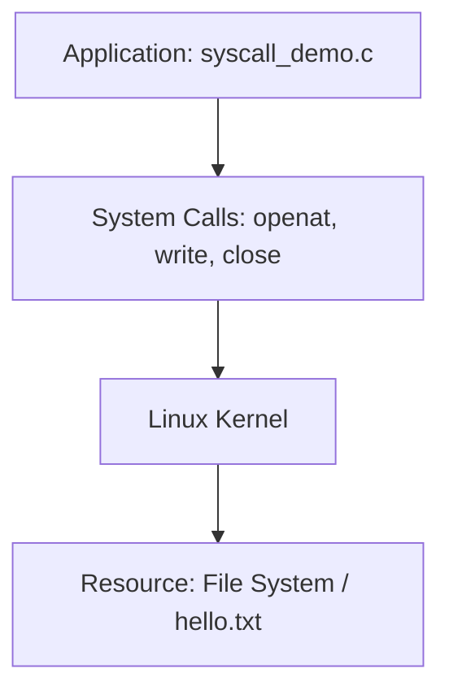

# Mission 2 — Meet the Kernel

## Objective
Understand how an application interacts with the Linux kernel through system calls.

## Experiment

Created a C program (`syscall_demo.c`) that:
1. Opens or creates `hello.txt`.
2. Writes a message into the file.
3. Closes the file.

### Execution

```bash
gcc syscall_demo.c -o syscall_demo
./syscall_demo
cat hello.txt
```

Output:

```text
Hello from user space!
```

## Evidence 1 — System Call Trace

Used `strace` to observe system calls:

```bash
strace -o trace.txt ./syscall_demo
```

Important calls identified:

```text
openat(AT_FDCWD, "hello.txt",
       O_WRONLY|O_CREAT|O_TRUNC, 0644) = 3

write(3, "Hello from user space!\n", 23) = 23

close(3) = 0
```

### Observations

- `openat()` opens the file and returns file descriptor 3.
- `write()` successfully writes 23 bytes.
- `close()` closes the file descriptor.

The C library's `open()` function uses the `openat()` system call on this Linux system.

## Evidence 2 — Application to Resource Diagram



### Conclusion

The experiment demonstrates how an application requests operating-system services through system calls. The Linux kernel handles these requests and performs the required file operations.
