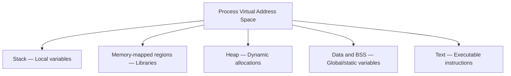

# Mission 4 — Can One Process Read Another?

## Objective
Observe a process's virtual address space and understand why a pointer from one process is not normally usable by another.

## Concepts
- Virtual addresses
- Memory mappings
- Memory Management Unit (MMU)
- Process isolation

## Experiment

Created and executed `address_space.c`.

The program declared a local integer variable:

```c
int secret = 12345;
```

It printed the process ID, variable address and variable value, then remained active for 30 seconds to allow inspection of its memory map.

### Compilation and execution

```bash
gcc -Wall -Wextra address_space.c -o address_space
./address_space
```

## Evidence 1 — Program Output

Observed results:

| Field | Value |
|---|---|
| PID | 3927 |
| Variable address | 0xfffff90a33e4 |
| Variable value | 12345 |

## Evidence 2 — Process Memory Map

Inspected the process using:

```bash
cat /proc/3927/maps
```

Important memory regions observed:

- Executable: `address_space`
- Heap: `[heap]`
- Shared library: `libc.so.6`
- Dynamic linker: `ld-linux-aarch64.so.1`
- Kernel-provided mappings: `[vvar]` and `[vdso]`
- Stack: `[stack]`

The stack mapping was:

```text
fffff9084000-fffff90a5000 rw-p ... [stack]
```

The address of the local variable, `0xfffff90a33e4`, falls within this stack mapping.

## Evidence 3 — Labelled Address-Space Diagram



## Think About It

### Q10. What does a process's address space contain?

A process's address space contains its executable code, global and static data, heap, stack, shared libraries and memory-mapped regions. Each region serves a different purpose during program execution.

### Q11. Why can't another ordinary process simply dereference the printed pointer?

The pointer belongs to the virtual address space of the process that created it. Another process has its own virtual address space, so the same numerical address may refer to a different memory location or may not be mapped at all.

### Q12. What role does hardware-assisted memory protection play?

The MMU translates virtual addresses into physical addresses using page tables. It also enforces access permissions, preventing a process from accessing memory it is not authorised to access.

## Short Explanation of Process Isolation

Linux gives each process its own virtual address space. The MMU and page tables ensure that processes can access only memory mapped and permitted for them. This prevents ordinary processes from directly accessing one another's private memory.

## Conclusion

This experiment demonstrated how Linux exposes a process's virtual memory layout through `/proc/PID/maps`. The local variable was found inside the stack mapping, illustrating how process memory is organised and isolated.
